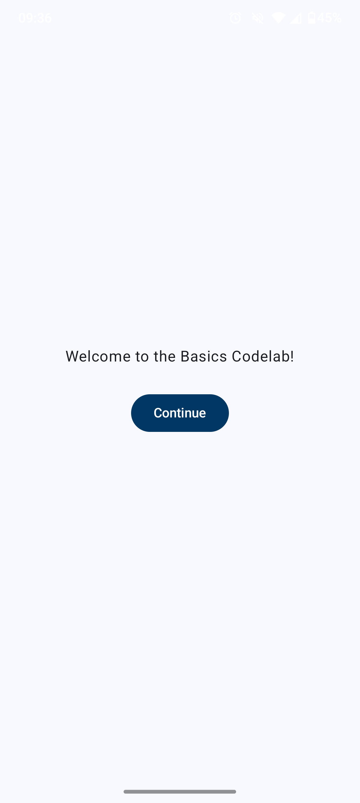
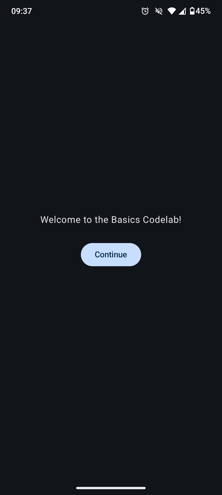
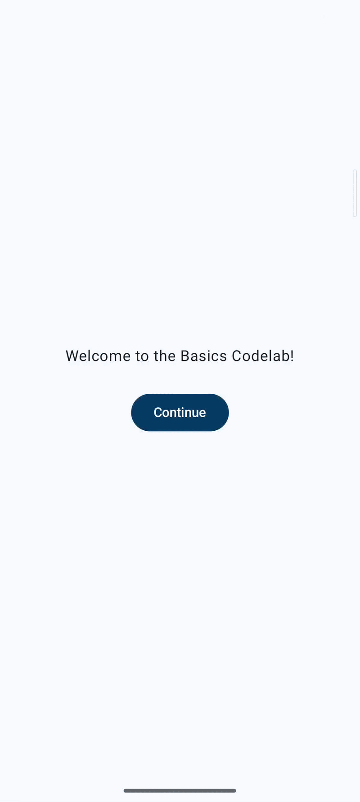

# Codelab: Noções Básicas do Jetpack Compose

Este repositório contém a implementação prática desenvolvida durante o codelab [**Basics Codelab (Noções Básicas do Jetpack Compose)**](https://developer.android.com/codelabs/jetpack-compose-basics?hl=pt-br#0), disponibilizado pelo Google.

O objetivo deste projeto é explorar os fundamentos da construção de interfaces declarativas no Android usando Kotlin e Jetpack Compose.

## Tecnologias e Ferramentas Utilizadas

- **Linguagem:** Kotlin
- **Toolkit UI:** Jetpack Compose
- **Design System:** Material Design 3 (Material You)
- **IDE:** Android Studio
- **Mínimo SDK:** API level 24+

## Conceitos e Aprendizados Práticos

Durante a realização deste codelab, os seguintes tópicos e conceitos foram praticados:

### 1. Declaração de UIs e Composables
- Uso da anotação `@Composable` para criar funções de interface declarativa.
- Utilização de composables fundamentais: `Text`, `Button`, `ElevatedButton`, `Card`, `Column`, `Row`, `LazyColumn` e `Surface`.
- Aplicação de `Modifier` para estilização (padding, tamanhos, cores, alinhamento e interações).

### 2. Gerenciamento de Estado (State Management)
- **`remember` e `mutableStateOf`:** Retenção de estado local durante as recomposições da UI.
- **`rememberSaveable`:** Preservação de estado em mudanças de configuração da tela (como rotação de dispositivo).
- **Elevação de Estado (State Hoisting):** Desacoplamento da lógica de estado das funções composables para tornar a UI reutilizável e testável.

### 3. Animações e Estilização
- Uso de `animateDpAsState` (ou `animateContentSize`) para transições suaves de expandir/recolher elementos da lista.
- Aplicação do tema da aplicação (`MaterialTheme.colorScheme`, `typography`) garantindo suporte nativo a **Modo Claro (Light Mode)** e **Modo Escuro (Dark Mode)**.

## Evidências do Projeto (Demonstração Prática)

### 1. Tela de Apresentação (Onboarding Screen)
Demonstração do fluxo inicial da aplicação solicitando ao usuário o início da experiência.

| Modo Claro | Modo Escuro |
| :---: | :---: |
|  |  |

### 2. Fluxo Completo: Lista Interativa, Animação e Preservação de Estado (GIF)
Demonstração do funcionamento da `LazyColumn`, da transição animada ao expandir/recolher os cards e da preservação do estado da interface ao rotacionar o dispositivo (graças ao uso de `rememberSaveable`).

| Demonstração Interativa |
| :---: |
|  |

## Preview e Ferramentas de Desenvolvimento

Anotações e recursos utilizados durante o desenvolvimento para aceleração de feedback:
- Uso do `@Preview` com diferentes configurações (Light/Dark Theme, Font Scaling e Device Specs).

## Como Executar o Projeto

1. Clone o repositório:
   ```bash
   git clone https://github.com/leticia-farias/nocoes-basicas-compose.git

2. Abra o projeto no **Android Studio** (versão Ladybug ou superior recomendada).
3. Aguarde o término da sincronização do **Gradle**.
4. Execute o aplicativo em um emulador ou dispositivo físico com Android 7.0 (API 24) ou superior.
